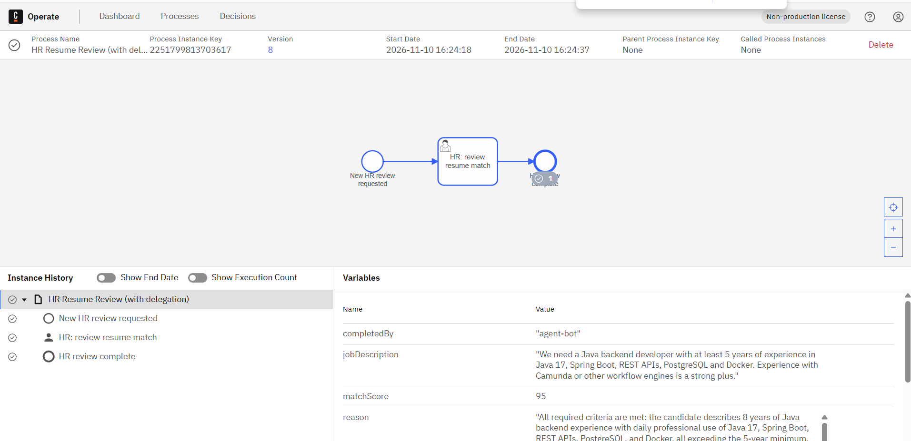
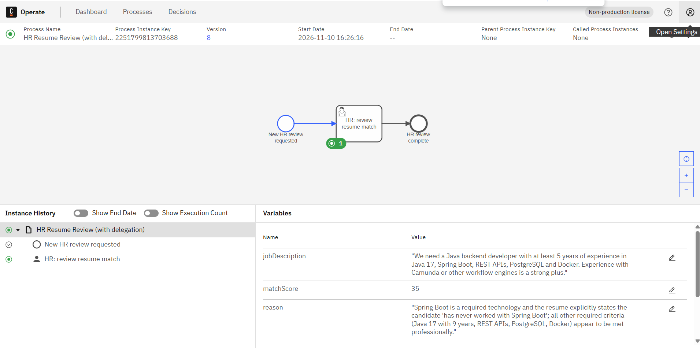
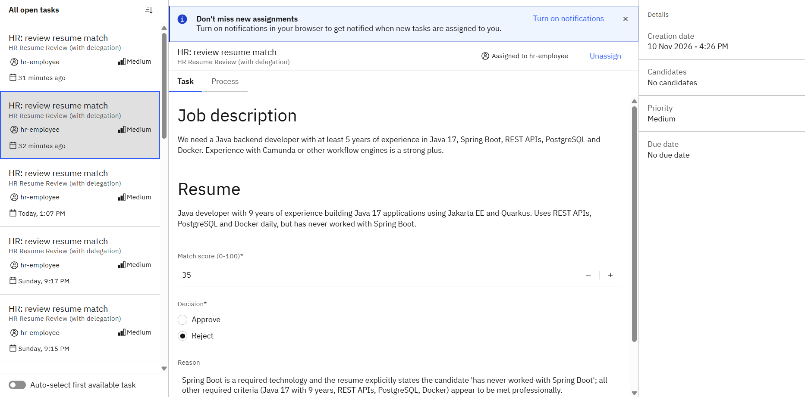
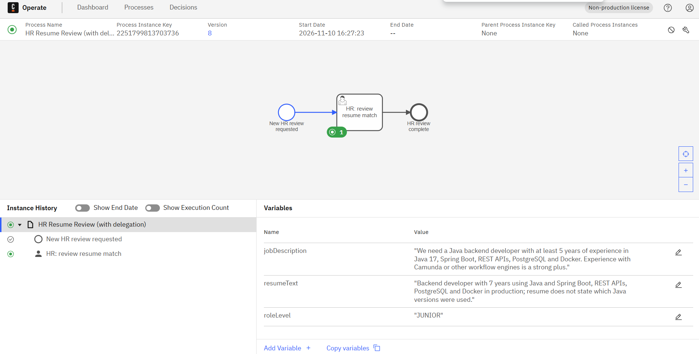
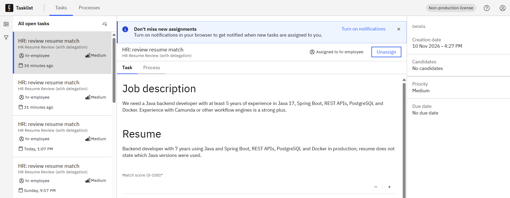
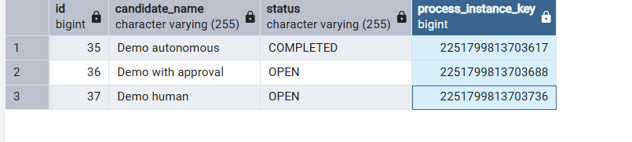

# Demo run, 10 November 2026

Three runs of the HR review process, one per autonomy level, with `roleLevel = JUNIOR`
(`hr-risk` allows `AGENT_AUTONOMOUS` before the work), skill `resume-review@3` and `hiring-policy@1`,
model `claude-sonnet-4-6`. The job description is the one from the golden dataset. All resumes are synthetic.

Only the application's `INFO` lines are shown; SQL logging is left out.

## 1. Autonomous: full match (c01)

```
Task 2251799813703639: autonomy before=AGENT_AUTONOMOUS, after=AGENT_AUTONOMOUS, final=AGENT_AUTONOMOUS
Task 2251799813703639 completed by agent-bot: verdict=APPROVED
```

The agent completes the task. The completion carries `completedBy = "agent-bot"`, so the
`record-human-review` listener skips it and no extra attempt is written.



## 2. With approval: no Spring Boot (c22)

```
Task 2251799813703710: autonomy before=AGENT_AUTONOMOUS, after=AGENT_WITH_APPROVAL, final=AGENT_WITH_APPROVAL
Task 2251799813703710 handed back to hr-employee for approval
```

The before-check allowed full autonomy; the after-check `hr-outcome` lowered it, because a rejection
needs a person. The strictest result wins. The proposal is set on the process, so the form shows it.





## 3. Human: Java version not stated (c23)

```
Task 2251799813703758: autonomy before=AGENT_AUTONOMOUS, after=HUMAN, final=HUMAN
Task 2251799813703758 handed back to hr-employee; agent proposal not shown
```

The agent answered `NEEDS_REVIEW`; `hr-outcome` and `hr-consistency` both give `HUMAN`. The proposal is
not set on the process (#46), so the person decides without seeing it.





## The three requests



## Recording the person's decision (#31)

Earlier runs on the same day (requests 22–24), completed as `hr-employee`. The agent's attempt stays as it
was; the person's decision is a separate `COMPLETED` attempt and becomes the request's final result.

| id | reviewer | status | verdict | score | proposal_review | request |
|---:|---|---|---|---:|---|---:|
| 19 | agent-bot | RESULT_SAVED | REJECTED | 30 | | 22 |
| 20 | hr-employee | COMPLETED | REJECTED | 30 | ACCEPTED | 22 |
| 21 | agent-bot | RESULT_SAVED | REJECTED | 30 | | 23 |
| 22 | hr-employee | COMPLETED | APPROVED | 70 | VERDICT_CHANGED | 23 |
| 23 | agent-bot | WITHDRAWN | NEEDS_REVIEW | 55 | | 24 |
| 24 | hr-employee | COMPLETED | APPROVED | 75 | NO_PROPOSAL | 24 |

The local Compose setup has no `hr-employee` login in Tasklist, so these completions were sent through the
Zeebe REST API (`/v2/user-tasks/{key}/completion`) on the task assigned to `hr-employee`. The listener logic is
the same; showing the form to a real second user is not demonstrated.

The model's score varies slightly between runs (30 in the morning, 35 in the afternoon for the same resume).
